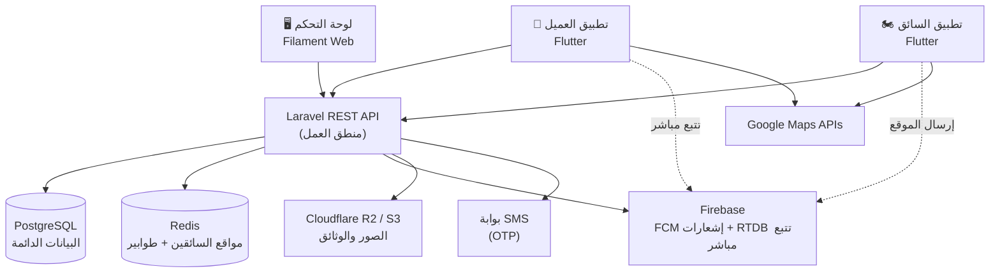
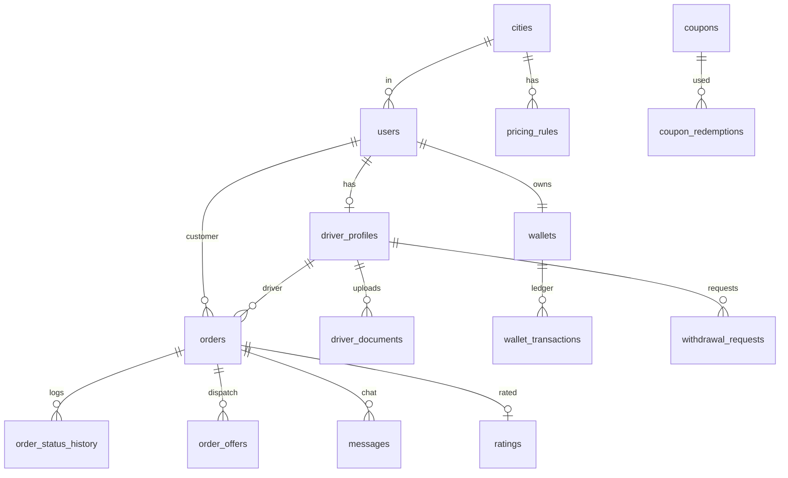
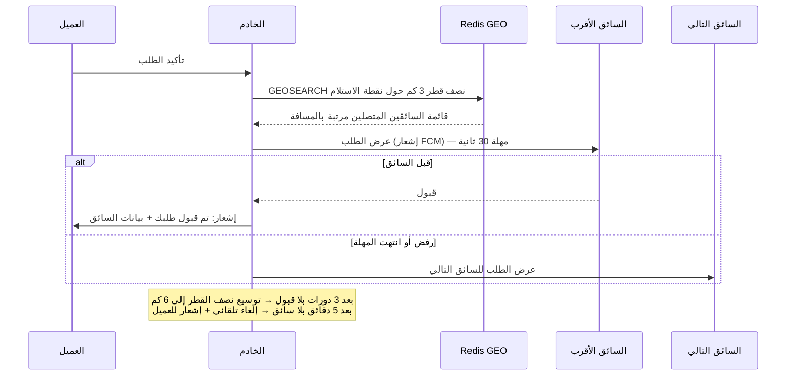
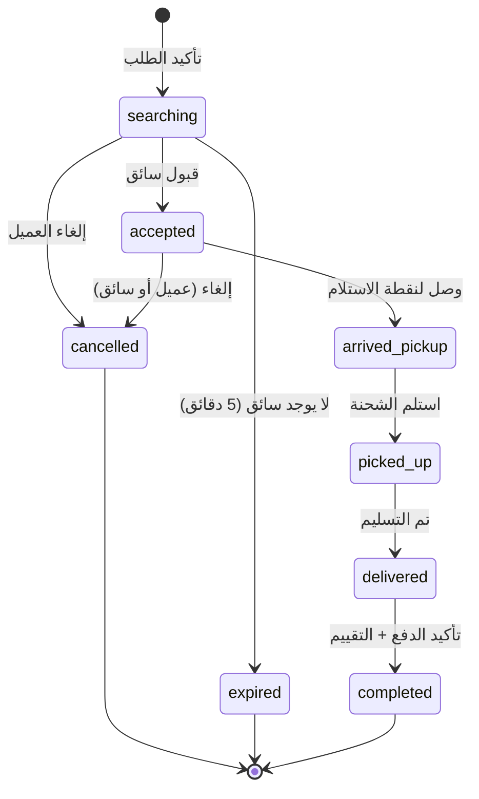

# المعمارية التقنية — تطبيق التوصيل بالدراجات النارية (MotoGo / LIVREE)

> هذه الوثيقة هي المرجع التقني الأساسي قبل البرمجة. تغطي القرارات التقنية، هيكل قاعدة البيانات، واجهات API، التتبع المباشر، توزيع الطلبات، التسعير، الدفع، والبنية التحتية — مع إجابات الأسئلة السبعة المطروحة على المطور.

---

## 1. نظرة عامة على النظام

النظام يتكون من **أربعة مكونات** تتشارك خادماً خلفياً واحداً (Backend) وقاعدة بيانات واحدة:

| المكون | التقنية | الوصف |
|---|---|---|
| تطبيق العميل | Flutter (Android + iOS) | إنشاء الطلبات، التتبع، الدفع، التقييم |
| تطبيق السائق | Flutter (Android أساساً) | استقبال العروض، الملاحة، الأرباح |
| لوحة التحكم | Laravel + Filament (ويب) | إدارة كاملة للنظام |
| الخادم الخلفي (API) | Laravel 11 (REST API) | منطق العمل، التسعير، التوزيع، المحاسبة |



**المبدأ الأساسي:** خادم واحد هو مصدر الحقيقة (Source of Truth) لكل شيء — الطلبات، الأسعار، الأرصدة. أما Firebase فيُستخدم فقط لما هو "لحظي وقابل للضياع": الإشعارات وبثّ موقع السائق.

---

## 2. القرارات التقنية والمبررات

| القرار | الاختيار الموصى به | المبرر | البديل |
|---|---|---|---|
| تطبيقات الموبايل | **Flutter** | كود واحد لأندرويد و iOS، أداء ممتاز للخرائط، دعم RTL للعربية | React Native |
| الخادم الخلفي | **Laravel 11 + PHP 8.3** | إطار واحد يغطي API + لوحة التحكم؛ Filament يبني لوحة إدارة كاملة في أيام بدل أسابيع؛ المطورون متوفرون في المنطقة | NestJS (Node.js) إن كان الفريق يفضل JavaScript |
| لوحة التحكم | **Filament 3** | مبنية فوق Laravel مباشرة، جداول وفلاتر وصلاحيات جاهزة | لوحة React منفصلة (تكلفة أعلى بكثير) |
| قاعدة البيانات | **PostgreSQL 16** | دعم PostGIS للاستعلامات الجغرافية لاحقاً، موثوقية عالية | MySQL 8 (مقبول تماماً) |
| الكاش والطوابير | **Redis** | أوامر GEO لإيجاد أقرب سائق بميلي ثانية، طوابير Laravel | — |
| التتبع المباشر | **Firebase Realtime DB** | السائق يكتب موقعه، العميل يشترك مباشرة — بدون بناء بنية WebSocket خاصة في المرحلة الأولى | Laravel Reverb (WebSockets ذاتية الاستضافة) في مرحلة لاحقة |
| الإشعارات | **Firebase Cloud Messaging** | مجاني وموثوق | — |
| تخزين الملفات | **Cloudflare R2** | متوافق مع S3 وبدون رسوم إخراج (egress)، أرخص خيار | Firebase Storage / AWS S3 |
| الخرائط | **Google Maps SDK** مع استراتيجية خفض التكلفة (القسم 12) | الأدق في نواكشوط | Mapbox / OpenStreetMap |
| رسائل OTP | بوابة SMS محلية أو Twilio، مع خيار **OTP عبر واتساب** (أرخص بكثير والانتشار واسع في موريتانيا) | التكلفة | — |

---

## 3. هيكل قاعدة البيانات

### المخطط العلائقي (الجداول الأساسية)



### تفصيل الجداول

**users** — كل المستخدمين (عملاء وسائقون وإداريون)
```
id, phone (unique), name, role [customer|driver|admin],
status [active|suspended], city_id, avatar_url,
fcm_token, locale [ar|fr], last_seen_at, created_at
```

**otp_codes**
```
id, phone, code_hash, expires_at, attempts, used_at
```

**driver_profiles** — بيانات السائق الإضافية
```
user_id (PK/FK), national_id_number, license_number,
vehicle_plate, approval_status [pending|approved|rejected],
rejection_reason, is_online, current_lat, current_lng,
location_updated_at, rating_avg, rating_count, city_id
```

**driver_documents** — وثائق السائق
```
id, driver_id, type [national_id|license|vehicle_photo|selfie],
file_url, status [pending|approved|rejected], reviewed_by, reviewed_at
```

**cities**
```
id, name_ar, name_fr, center_lat, center_lng, radius_km, is_active
```

**pricing_rules** — تسعير قابل للتعديل من لوحة التحكم لكل مدينة
```
id, city_id, order_type, base_fee (40), per_km_fee (2),
waiting_fee_per_min, free_waiting_minutes (10), min_fare,
commission_percent, effective_from
```

**orders** — قلب النظام
```
id, code (رقم قصير للعرض), customer_id, driver_id, city_id,
type [food|goods|purchase|documents],
status (انظر دورة الحياة في القسم 7),
pickup_lat, pickup_lng, pickup_address,
dropoff_lat, dropoff_lng, dropoff_address,
description, photo_url,
distance_km, price_base, price_distance, price_waiting,
price_discount, price_total, commission_amount,
payment_method [cash|wallet|card], coupon_id,
accepted_at, picked_up_at, delivered_at,
cancelled_at, cancelled_by [customer|driver|admin|system], cancel_reason
```

**order_status_history** — سجل تدقيق لكل تغيير حالة
```
id, order_id, status, actor_type, actor_id, lat, lng, created_at
```

**order_offers** — عروض التوزيع على السائقين
```
id, order_id, driver_id, sent_at, responded_at,
response [accepted|rejected|timeout]
```

**wallets + wallet_transactions** — نظام محاسبة بدفتر قيود (Ledger)
```
wallets: id, user_id, balance, currency (MRU)
wallet_transactions: id, wallet_id, order_id?, 
  type [delivery_earning|commission|topup|withdrawal|adjustment],
  amount (موجب أو سالب), balance_after, note, created_by, created_at
```
> **قاعدة ذهبية:** الرصيد لا يُعدَّل مباشرة أبداً — كل تغيير يمر عبر قيد في `wallet_transactions`. هذا يمنع أي خلاف محاسبي مع السائقين.

**withdrawal_requests**
```
id, driver_id, amount, method [bankily|masrvi|cash],
account_ref, status [pending|paid|rejected], processed_by, processed_at
```

**ratings**
```
id, order_id, rater_id, ratee_id, stars (1-5), comment
```

**coupons + coupon_redemptions**
```
coupons: id, code, type [percent|fixed], value, max_uses,
  per_user_limit, min_order, starts_at, ends_at, city_id, is_active
coupon_redemptions: id, coupon_id, user_id, order_id
```

**messages** — دردشة مرتبطة بالطلب فقط
```
id, order_id, sender_id, type [text|image], body, created_at
```

**notifications, audit_logs, settings** — جداول مساندة قياسية.

> **ملاحظة:** مواقع السائقين اللحظية **لا تُخزَّن** في PostgreSQL كل ثانية (سيغرق الجدول بملايين الصفوف). تُحفظ في Redis و Firebase فقط، مع لقطة أخيرة في `driver_profiles`.

---

## 4. واجهات API (REST — `/api/v1`)

### المصادقة (OTP)
```
POST /auth/otp/request      → إرسال رمز إلى الهاتف
POST /auth/otp/verify       → التحقق وإرجاع JWT + Refresh Token
POST /auth/refresh
POST /auth/logout
```

### العميل
```
GET  /me                            الملف الشخصي
PUT  /me
POST /orders/quote                  حساب السعر قبل التأكيد (نقاط الالتقاط والتسليم)
POST /orders                        إنشاء الطلب
GET  /orders                        سجل الطلبات
GET  /orders/{id}                   تفاصيل + حالة الطلب
POST /orders/{id}/cancel
POST /orders/{id}/rating
GET  /orders/{id}/messages          الدردشة
POST /orders/{id}/messages
POST /coupons/validate              فحص كوبون
GET  /orders/{id}/share-token       رابط مشاركة التتبع مع الأسرة
```

### السائق
```
POST /driver/register               التسجيل + رفع الوثائق
POST /driver/documents
PUT  /driver/status                 متصل / غير متصل
POST /driver/location               تحديث الموقع (كل 10 ثوانٍ عبر API + كل 3 ثوانٍ عبر Firebase)
POST /offers/{id}/accept            قبول عرض طلب
POST /offers/{id}/reject
POST /orders/{id}/arrived-pickup    وصلت لنقطة الاستلام
POST /orders/{id}/picked-up         استلمت الطلب
POST /orders/{id}/delivered         تم التسليم (+ تأكيد استلام المبلغ نقداً)
GET  /driver/earnings               ملخص الأرباح (يومي/أسبوعي)
GET  /driver/wallet                 كشف الحساب
POST /driver/withdrawals            طلب سحب
```

### الإدارة
معظم عمليات الإدارة تتم عبر واجهة Filament مباشرة (بدون API منفصل)، مع نقاط مخصصة مثل:
```
POST /admin/drivers/{id}/approve | reject | suspend
POST /admin/notifications/broadcast
GET  /admin/reports/revenue?from=&to=
```

---

## 5. التتبع المباشر (Live Tracking)

**التدفق:**

1. تطبيق السائق يقرأ GPS كل **3 ثوانٍ** أثناء وجود طلب نشط، وكل **15 ثانية** وهو متصل بدون طلب.
2. يكتب الموقع في مسار Firebase RTDB: `/driver_locations/{driver_id}` → `{lat, lng, heading, ts}`.
3. تطبيق العميل يشترك في هذا المسار **فقط أثناء طلب نشط** (قواعد أمان Firebase تربط الإذن بوجود طلب يجمع الطرفين).
4. بالتوازي، السائق يرسل موقعه إلى API كل 10 ثوانٍ → يُحدَّث في **Redis GEO** (لأغراض التوزيع) وفي لقطة `driver_profiles`.

**لماذا هذا التصميم؟** بثّ الموقع للعميل لا يحتاج المرور بالخادم إطلاقاً (زمن استجابة أقل + حمل أقل على الخادم)، بينما يحتفظ الخادم بنسخة كافية لاتخاذ قرارات التوزيع.

**مشاركة التتبع مع الأسرة:** رابط ويب بسيط بتوكن مؤقت يعرض خريطة الطلب دون تسجيل دخول.

---

## 6. توزيع الطلبات (Dispatch — أقرب سائق)



**تفاصيل التنفيذ:**
- السائقون المتصلون مسجلون في Redis: `GEOADD drivers:online:{city_id} lng lat driver_id`.
- العرض يُرسل **لسائق واحد في كل مرة** (وليس للجميع) لتفادي سباق القبول وخداع المسافات.
- كل عرض يُسجَّل في `order_offers` — نسبة الرفض مؤشر أداء للسائق تظهر في لوحة التحكم.
- المهلة (30 ث)، نصف القطر (3 كم)، وعدد الدورات: كلها إعدادات قابلة للتعديل من لوحة التحكم.

---

## 7. دورة حياة الطلب (State Machine)



**قواعد الانتقال:**
- كل انتقال يُسجَّل في `order_status_history` مع إحداثيات السائق لحظتها (حماية من النزاعات).
- إلغاء السائق بعد القبول → الطلب يعود تلقائياً إلى `searching` ويُعاد توزيعه، ويُسجَّل الإلغاء على السائق.
- رسوم الانتظار تبدأ حسابها من `arrived_pickup` بعد انقضاء الدقائق المجانية (10 دقائق).
- الانتقالات محمية على مستوى الخادم: لا يمكن القفز من `accepted` إلى `delivered` مباشرة.

---

## 8. محرك التسعير

```
السعر = رسوم الفتح (40 MRU)
      + المسافة بالكيلومتر × 2 MRU
      + دقائق الانتظار الزائدة × رسوم الدقيقة
      − الخصم (كوبون)
      مع حد أدنى (min_fare)
```

- **حساب المسافة في المرحلة الأولى:** معادلة Haversine (خط مستقيم) × معامل طرق **1.4** — بدون أي تكلفة API. دقتها كافية لمدينة مثل نواكشوط ذات الشوارع الشبكية.
- **لاحقاً:** التبديل إلى Google Distance Matrix لمسافة الطريق الفعلية (استدعاء واحد لكل عرض سعر فقط).
- كل المعاملات (رسوم الفتح، سعر الكيلومتر، العمولة…) في جدول `pricing_rules` لكل مدينة ونوع طلب — تعديلها من لوحة التحكم **دون تحديث التطبيق**.
- السعر يُحسب ويُثبَّت عند إنشاء الطلب (`orders.price_*`) — تغيير الأسعار لاحقاً لا يمس الطلبات القائمة.

---

## 9. الدفع، المحفظة، والعمولة

### المرحلة الأولى: نقداً فقط — لكن المحاسبة إلكترونية منذ اليوم الأول

هذه أهم نقطة تصميم في المشروع. عندما يدفع العميل **نقداً للسائق**، فالتطبيق لم يقبض عمولته بعد. الحل:

1. عند إتمام الطلب: يُسجَّل قيدان في محفظة السائق:
   - `delivery_earning`: + قيمة التوصيل (قبضها نقداً)
   - `commission`: − عمولة التطبيق (مثلاً 15٪)
2. رصيد السائق يصبح **سالباً بقيمة العمولات المتراكمة** (هو مدين للتطبيق).
3. السائق يسدد عبر **شحن رصيده** (Bankily/نقداً في المكتب) أو تسوية أسبوعية.
4. إعداد في لوحة التحكم: **حد أقصى للمديونية** (مثلاً −500 MRU) — تجاوزه يوقف استقبال الطلبات تلقائياً حتى السداد. هذه هي آلية تحصيل العمولة الوحيدة الموثوقة مع الدفع النقدي.

### المرحلة الثانية: المحافظ المحلية
- **Bankily** (BMCI) و **Masrvi** — الأوسع انتشاراً في موريتانيا، ثم Sedad وغيرها.
- التكامل عبر واجهاتها التجارية (تتطلب اتفاقيات تجارية — يُنصح ببدء التواصل معها مبكراً لأن الإجراءات تأخذ وقتاً).
- عند الدفع الإلكتروني تنعكس المعادلة: التطبيق يقبض كامل المبلغ ويصبح **مديناً للسائق** بأرباحه — نفس دفتر القيود يغطي الحالتين.

---

## 10. الإشعارات

| الحدث | المستقبِل | القناة |
|---|---|---|
| عرض طلب جديد | السائق | FCM (أولوية عالية + صوت مخصص) |
| قبول الطلب | العميل | FCM |
| السائق وصل للاستلام / التسليم | العميل | FCM |
| بدء التوصيل / قرب الوصول | العميل | FCM |
| إتمام الطلب + طلب التقييم | العميل | FCM |
| قبول/رفض وثائق السائق | السائق | FCM + SMS |
| إشعارات جماعية (عروض) | الجميع | FCM Topics حسب المدينة |

كل إشعار يُخزَّن أيضاً في جدول `notifications` ليظهر داخل التطبيق حتى لو فاته المستخدم.

---

## 11. الأمان

- **المصادقة:** OTP عبر SMS/واتساب → JWT قصير العمر (15 دقيقة) + Refresh Token (30 يوماً). لا كلمات مرور للعملاء والسائقين إطلاقاً.
- **منع الحسابات الوهمية:** رقم هاتف واحد = حساب واحد؛ حد أقصى لمحاولات OTP (5 محاولات/ساعة لكل رقم و IP)؛ بصمة الجهاز (device_id) لرصد تكرار الحسابات.
- **الصلاحيات:** فصل صارم بين أدوار API (عميل/سائق/إدارة) عبر Middleware؛ قواعد أمان Firebase تمنع قراءة موقع سائق إلا لعميل لديه طلب نشط معه.
- **التشفير:** TLS إجباري لكل الاتصالات؛ الوثائق في R2 بروابط موقعة مؤقتة (Signed URLs) — ليست عامة أبداً.
- **سجل التدقيق:** كل عملية إدارية (تعديل سعر، إيقاف حساب، تسوية رصيد) تُسجَّل في `audit_logs`.
- **النسخ الاحتياطي:** `pg_dump` يومي مشفَّر يُرفع إلى R2، مع الاحتفاظ بـ 30 نسخة، واختبار استعادة شهري.

---

## 12. الخرائط: استراتيجية خفض التكلفة

| الاستخدام | الحل | التكلفة |
|---|---|---|
| عرض الخريطة في التطبيقين | Google Maps Mobile SDK | **مجاني بلا حدود** على الموبايل |
| حساب مسافة التسعير | Haversine × 1.4 (بدون API) | صفر |
| ملاحة السائق | فتح تطبيق خرائط Google نفسه (Deep Link بالإحداثيات) | صفر |
| البحث عن عنوان | تحديد بالدبوس على الخريطة أولاً + Geocoding عند الحاجة فقط | شبه صفر |
| تتبع العميل للسائق | Firebase RTDB (ليست خدمة خرائط) | ضمن الحصة المجانية |

بهذه الاستراتيجية تكلفة الخرائط في مرحلة MVP **قريبة من الصفر**، مع بقاء الترقية إلى Distance Matrix و Places Autocomplete متاحة عند نمو الإيرادات. البديل الكامل (Mapbox / OpenStreetMap) يبقى خياراً إن تغيّرت أسعار Google، لكن دقة بياناتهما في نواكشوط أضعف.

---

## 13. البنية التحتية والنشر

```
VPS واحد (مثل Hetzner CX32: 4 vCPU / 8GB RAM ≈ 15$/شهر)
└── Docker Compose:
    ├── nginx (TLS عبر Let's Encrypt)
    ├── laravel-app (PHP-FPM)
    ├── laravel-queue-worker (طوابير الإشعارات والتوزيع)
    ├── laravel-scheduler (المهام الدورية: مهلات العروض، النسخ الاحتياطي)
    ├── postgres
    └── redis
```

- **التكلفة الشهرية التقديرية للمرحلة الأولى:** خادم ~15$ + R2 ~2$ + Firebase (الحصة المجانية تكفي) + تكلفة SMS حسب الحجم ≈ **أقل من 30$/شهر** عدا الرسائل.
- **المراقبة:** Sentry (أخطاء التطبيقات والخادم) + Uptime Kuma (توفر الخدمة).
- **بيئتان:** staging و production، مع نشر عبر GitHub Actions.
- هذا الخادم يتحمل بسهولة آلاف الطلبات يومياً؛ التوسع لاحقاً يكون بفصل قاعدة البيانات ثم تعدد خوادم التطبيق خلف موزّع حمل.

---

## 14. هيكل مجلدات المشروع

```
LIVREE/
├── backend/              # Laravel: API + Filament admin + الطوابير
├── apps/
│   ├── customer/         # Flutter — تطبيق العميل
│   └── driver/           # Flutter — تطبيق السائق
├── packages/
│   └── shared/           # كود Flutter مشترك (الموديلات، عميل API، الثيم)
├── docs/                 # هذه الوثيقة + وثائق API
└── docker-compose.yml
```

> تطبيقا العميل والسائق يتشاركان حزمة `shared` (نماذج البيانات، طبقة الاتصال بالـ API، الترجمة العربية/الفرنسية) — يقلل التكرار ويضمن الاتساق.

---

## 15. إجابات الأسئلة السبعة

**1. ثلاثة تطبيقات أم اثنان؟**
تطبيقان (عميل + سائق) بـ Flutter، ولوحة تحكم **ويب** بـ Filament — ليست تطبيق موبايل. دمج العميل والسائق في تطبيق واحد يوفر قليلاً في البداية لكنه يعقّد الصلاحيات والتحديثات ويشوّه تجربة الاستخدام؛ الفصل هو الصواب، والحزمة المشتركة تلغي معظم التكرار.

**2. Google Maps أم بديل؟**
Google Maps مع الاستراتيجية في القسم 12: عرض الخرائط والملاحة مجانيان، والتسعير بمعادلة رياضية بلا API — فالتكلفة شبه معدومة في MVP ولا مبرر للتضحية بجودة بيانات Google في موريتانيا.

**3. حساب السعر؟**
هجين: رسوم فتح ثابتة + سعر لكل كيلومتر (Haversine × 1.4) + رسوم انتظار، بحد أدنى، وكلها قابلة للتعديل لكل مدينة من لوحة التحكم. التسعير بالمناطق (Zones) يمكن إضافته لاحقاً كطبقة فوق نفس الجدول.

**4. تعيين السائق؟**
**أقرب سائق تلقائياً** بنظام العروض المتتالية (القسم 6). نموذج "العميل يختار من عروض السائقين" يبطئ كل طلب ويعقّد التجربة — لا يناسب التوصيل السريع (هو نموذج مشاوير الركاب مثل inDrive).

**5. العمل عند ضعف الشبكة؟**
جزئياً: تحديثات موقع السائق تُخزَّن محلياً وتُرسَل عند عودة الاتصال؛ حالة الطلب الأخيرة مخزنة في التطبيق؛ إعادة المحاولة تلقائية لكل الطلبات الفاشلة؛ وزر اتصال هاتفي مباشر بالسائق كبديل دائم للدردشة. أما إنشاء طلب جديد فيتطلب اتصالاً بالضرورة.

**6. عمولة التطبيق؟**
نسبة مئوية (تبدأ بـ 10–15٪) تُسجَّل كقيد على محفظة السائق فور إتمام كل طلب. مع الدفع النقدي يتراكم دين السائق وتُحصَّل العمولة عبر حد المديونية الذي يوقف استقبال الطلبات (القسم 9) — هذه هي الآلية الوحيدة الموثوقة عملياً.

**7. التوسع لمدن أخرى؟**
مبني في التصميم منذ اليوم الأول: جدول `cities` + تسعير لكل مدينة + سائقون مرتبطون بمدينة + طوابير توزيع منفصلة لكل مدينة في Redis + إشعارات جماعية حسب المدينة. فتح مدينة جديدة (نواذيبو مثلاً) = صف جديد في لوحة التحكم، **بدون أي تعديل برمجي**.

---

## 16. خارطة الطريق التقنية

### المرحلة الأولى — MVP (الأساس أعلاه بالكامل)
1. الخادم: المصادقة OTP، جداول القاعدة، محرك التسعير، آلة حالات الطلب، التوزيع
2. لوحة التحكم: الموافقة على السائقين، إدارة الطلبات والأسعار والمدن
3. تطبيق العميل: طلب → سعر → تأكيد → تتبع → تقييم (دفع نقدي)
4. تطبيق السائق: تسجيل بالوثائق → استقبال العروض → تنفيذ → أرباح

### المرحلة الثانية
كوبونات (الجداول جاهزة) • شحن المحفظة عبر Bankily/Masrvi • دردشة داخل الطلب • تقارير متقدمة • برنامج الدعوات والنقاط

### المرحلة الثالثة
حسابات المطاعم والمتاجر (كتالوج + طلبات واردة) • جدولة الطلبات • اشتراكات شهرية للشركات • واجهة API للشركاء

---

*آخر تحديث: 21 يوليو 2026*
